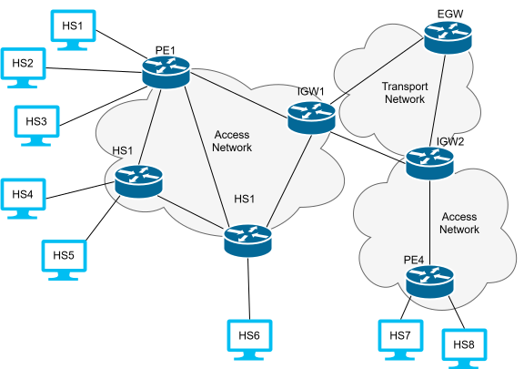

# SRv6 Data Center Demo with AI Agent

[](https://github.com/netgroup/clab-srv6-dc-4hs_2lf_2sp-demo)  
[](https://www.gnu.org/licenses/gpl-3.0)

A **containerized SRv6 network simulation** enhanced with **AI Agents** to automate tunnel creation, validation, and rollback.

---

## ⚡ Key Features

- 17-node topology: 8 hosts, 7 routers (PE/IGW/EGW), Master, Message Queue  
- AI Agent-driven **Planner & Executor** for automated SRv6 tunnel management  
- **Containerized simulation** using Docker & Containerlab  
- **VRF-aware SRv6 routing** with uSID & NEXT-CSID  
- Transaction-based management with rollback support  
- Easy deployment with Makefile (`docker`, `deploy`, `connect`, `destroy`)

---

## 📁 Topology Overview

```
Hosts: hs1-hs8
PE Routers: pe1-pe4
IGW Routers: igw5-igw6
EGW Router: egw7
Master Node: master
Message Queue: rabbitmq
```

**Topology Diagram:**



> All PE, IGW, and EGW routers are referred to as **routers**.

---

## 🧠 Master Node & AI Agents

The **Master node** runs two agents:

| Agent      | Role |
|-----------|------|
| Planner   | Interprets user requests, discovers routes, creates transactions for SRv6 tunnels |
| Executor  | Executes commands for tunnel creation or rollback, validates via routers |

**Workflow Example:**
1. Planner receives a request to create tunnel **H1 ↔ H5**
2. Two transactions are created: H1→H5 and H5→H1
3. Executor:
   - Reads network state
   - Generates JSON messages (`encap` / `decap`)
   - Sends messages to routers
   - Waits for all confirmations
4. On failure or timeout (default 60s), Executor triggers rollback
5. Planner verifies tunnels and waits for next user request

**Master Architecture Diagram:**


> **Important:** The AI Agents require a **Google AI API token**. Create a `.env` file in the same folder as the Makefile:

```bash
# .env
API_KEY=<YOUR_GOOGLE_AI_TOKEN>
```

---

## 🤖 Router Daemon

Each router runs a **daemon** that listens to messages from the Master:

| Message Type       | Description |
|------------------|-------------|
| `encap`           | Configure IPv4→SRv6 encapsulation route |
| `decap`           | Configure SRv6 decapsulation (End.DT4) |
| `encap_rollback`  | Remove encapsulation route |
| `decap_rollback`  | Remove decapsulation route |
| `validator`       | Validate SRv6 tunnel by sending test ICMP packets |

**Validator Workflow:**
- Spawn temporary thread to sniff packets
- Send ICMP encapsulated in SRv6
- Wait for ICMP reply
- Respond success or error to Master

All logs are stored in `/var/log/output_demone.log`.


## 🚀 Deployment

### Prerequisites

- Linux (tested Ubuntu 24.04)
- Docker 20.10+
- Containerlab 1.0+
- Kernel modules: `vrf`, `dummy`

```bash
# Load kernel modules
sudo modprobe vrf dummy
```

---

### Environment Setup

```bash
git clone -b noinet <repository-url>
cd clab-srv6-dc-4hs_2lf_2sp-demo

# Create .env file for AI agent
echo "API_KEY=<YOUR_GOOGLE_AI_TOKEN>" > .env
```

---

### Build Docker Image

```bash
make docker
```

---

### Deploy Testbed

```bash
sudo make deploy
```

---

### Access Nodes

```bash
# Hosts / routers
make connect NODE=hs1
make connect NODE=pe1
make connect NODE=pe2

# Master node (starts AI agent session)
make connect NODE=master

### Cleanup

```bash
make destroy
```

---

## ⚙ Development

### Structure

```
.
├── AGENTS.md
├── Dockerfile
├── Makefile
├── README.md
├── requirements.txt
├── scripts/
│   ├── configs/            # Configurazioni PE/IGW/EGW
│   └── lib/
│       ├── agent_ai/       # Planner ed Executor
│       ├── demone_router/  # Router daemon e validator
│       ├── host.sh
│       ├── router.sh       # PE/IGW/EGW
│       ├── startup.sh
│       └── wait_iface.sh
├── topo.yaml
└── .env                    # Token API Google AI
```

---

### Contributing

- Use Bash strict mode: `set -euo pipefail`  
- Document SRv6 & AI logic  
- Test tunnels and rollback functionality  

### Usage Example with AI Agent

**Before tunnel creation:**

```bash
make connect NODE=hs1
ping -c3 10.0.5.1  # IP of hs5
```
> All packets will be lost!

**Connect to master to use AI agent:**

```bash
make connect NODE=master
```

> You will see an interface directly connected to the agent:

```
Connecting to node master ...
SRv6 Planner Ready
User > Puoi crearmi un tunnel hs1 a hs5?
```

After a short wait for success response, the tunnel will be created.

**Test connectivity again:**

```bash
make connect NODE=hs1
ping -c3 10.0.5.1
```

> You may notice that the ping now succeeds!

---

## 📚 References

- [RFC 8200](https://tools.ietf.org/html/rfc8200) – IPv6  
- [RFC 8402](https://tools.ietf.org/html/rfc8402) – Segment Routing Header  
- [RFC 8986](https://tools.ietf.org/html/rfc8986) – SRv6 Network Programming  
- [Containerlab Documentation](https://containerlab.dev/)

---

## 📝 License

**GNU GPL v3.0** – see [LICENSE.txt](LICENSE.txt)
